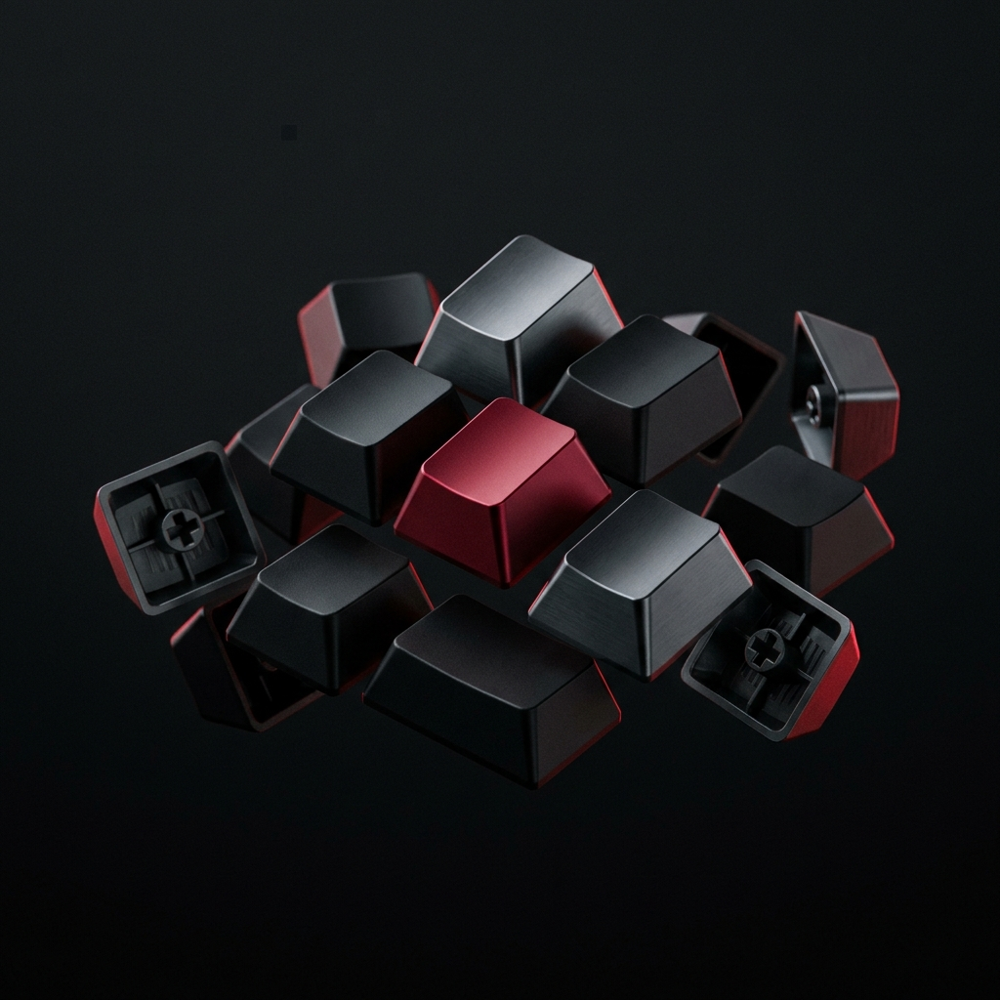
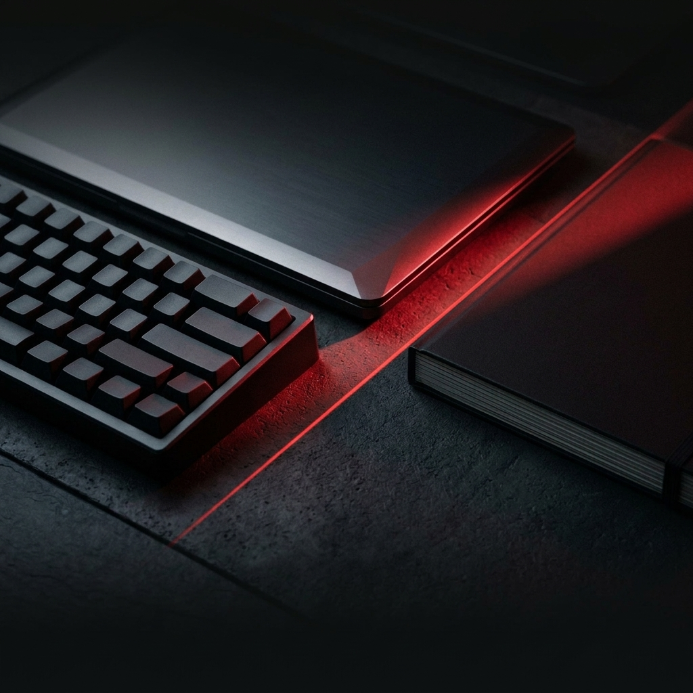

<div align="center">

# HRZ // 02 — 3D Interactive Portfolio

### *Editorial brutality meets real-time WebGL: 5 morphing GPU particle worlds, Lenis + GSAP parallax, an interactive 3D mechanical keycap lab, and 21 shipped projects.*

[](https://nextjs.org/)
[](https://docs.pmnd.rs/react-three-fiber)
[](https://www.typescriptlang.org/)
[](https://gsap.com/)
[](https://lenis.darkroom.engineering/)
[](https://pages.cloudflare.com/)
[](LICENSE)

<br />




</div>

---

## Overview

**HRZ // 02** is the personal developer portfolio of **Haris Al-Harraz Bin Razali** (`@risterz`) — a Full Stack Web Developer and Software Engineer based in Pahang, Malaysia.

Built around a **three-layer design token architecture** (`#1d1d1b` matte charcoal, `#ffffff` architectural hairlines, `#d32941` crimson accent, and `Clash Display` + `Plus Jakarta Sans`), the entire site sits over a **single persistent WebGL canvas** whose 24,000 GPU-simulated particles dynamically morph into five distinct 3D sculptures as you scroll through each section.

---

## Signature Highlights

### 1. Five Morphing GPU Particle Formations
All particle physics run on the GPU via custom GLSL simplex-flow vertex & fragment shaders (`src/components/3d/ParticleUniverse.tsx`) with adaptive hardware budgets (`24,000` discrete / `15,000` integrated / `9,000` mobile) and portrait-responsive camera framing:

| Section | 3D Formation | Palette | Visual Role |
| :--- | :--- | :--- | :--- |
| **Hero** | Living Crimson Orb | `#d32941` → `#ff3b57` | Breathing volumetric focal sphere behind the 3D-tilting wordmark |
| **Work** | Rotating Hollow Torus Ring | Dynamic per hovered project | Luminous halo around viewport edges keeping project copy legible |
| **Skills** | Flowing 3D Terrain Wave | `#d32941` → `#ff5268` | Undulating particle topography sweeping below the keycap lab |
| **About / Journey** | Right-Flank Double Helix | `#d32941` → `#ff7a45` | Sculptural spinning nebula framing the editorial bio and timeline |
| **Contact** | Rising Horizon Dunes | `#fd2a42` → `#d32941` | Sweeping crimson ridge beneath the hollow `LET'S CONNECT.` CTA |

### 2. Interactive HUD & Studio Controls
- **`HRZ // 02` Monogram Preloader:** Chamfered architectural core pillar charging `00 → 100%` before morphing the particle cloud open.
- **`mix-blend-mode: difference` Header:** Live `Asia/Kuala_Lumpur` clock (`PAHANG HH:MM:SS`), availability indicator, section anchors, and a scroll-docking `HRZ//02` wordmark.
- **Glass Hairline Bottom HUD:** Live `130px` Lenis scroll progress bar, **`DON'T TOUCH`** full-screen crimson difference inversion toggle, accessible **`0%–100%` Flux/Chaos slider** (dials particle curl speed, neon cyan/magenta palette shift, and scroll skew), equalizer pulse toggle, and a mobile pull-tab drawer.
- **Custom Blend Cursor:** Desktop-only `30px` `difference` dot expanding into `80px` `#d32941` context badges (`VIEW`, `LIVE`, `CODE`, `DRAG`, `COPY`, `FLUX`, `CHAOS`).

### 3. Editorial Parallax & Interactive Labs
- **Stair-Down Portal Cards:** Desktop left-to-right staggered parallax portals (`WORK`, `SKILLS`, `ABOUT`) paired with uniform equal-gap stacking on mobile via `gsap.matchMedia()`.
- **21 Shipped GitHub Projects:** Filterable showcase (`ALL`, `3D & WEBGL`, `WEB & EDITORIAL`, `TOOLS & AI`, `SYSTEMS & GAMES`) with GSAP image Y-parallax, pointer micro-tilt, gradient-clip text reveals, per-project particle color tinting, and a sharp-framed keyboard-navigable lightbox modal.
- **3D Mechanical Keycap Constellation:** Orbit, zoom, and hover custom procedural 3D keycaps representing core technologies (`SkillsConstellation.tsx`).
- **Draggable Studio Stamp & Scroll Skew:** Physics-smoothed `.rotable` velocity skew (amplified by the Flux slider) and a bounded `GSAP Draggable` `HRZ.02` stamp.
- **Direct Gmail Delivery:** Serverless contact form powered by Web3Forms with spam honeypot, loading/error states, and one-click clipboard email copy.

---

## Featured Projects Directory (21 Shipped)

| Category | Projects |
| :--- | :--- |
| **3D & WebGL** | [Haris 3D World](https://haris-3d-world.pages.dev) · [DONUTVERSE](https://donutverse.pages.dev) · [RoomForge 3D](https://roomforge-3d.pages.dev) · [KeyThock 3D](https://keythock.pages.dev) · [HIV Molecular Lab 3D](https://hiv-molecular-lab-3d.pages.dev) · [HIV Atlas](https://hiv-atlas.pages.dev) · [COSMOS Explorer](https://cosmos-explorer-prz.pages.dev) |
| **Web & Editorial** | [Ember & Olive](https://ember-olive-6v6.pages.dev) · [NEOMARKET](https://neomarket-1v5.pages.dev) · [Windows 98 Web OS](https://windows98-emulator.pages.dev) · [KAFA Sirah](https://kafa-sirah.vercel.app) |
| **Tools & AI** | [SonicShift (FFmpeg.wasm)](https://sonicshift-mp3.pages.dev) · [Papercraft PDF](https://papercraft-pdf.pages.dev) · [PantryPal AI](https://pantrypal-ai-nine.vercel.app) · [Gemini Web UI](https://gemini-crack.onrender.com) |
| **Systems & Games** | [FreeFetch (Rust/Tauri)](https://github.com/risterz/FreeFetch) · [Shuffle Puzzle (CF D1)](https://shuffle-puzzle.harisharraz02.workers.dev/) · [UNO Online](https://uno-card-game-335.pages.dev) · [PixelVault](https://pixelvault-30v.pages.dev) · [StegoBox](https://github.com/risterz/StegoBox) · [VidHarvester](https://github.com/risterz/VidHarvester) |

---

## Project Architecture

```text
src/
├── app/
│   ├── layout.tsx               # Fontshare Clash Display + Plus Jakarta Sans + SEO metadata
│   ├── globals.css              # Base system, blend modes, chaos overlay, marquee & a11y focus
│   └── page.tsx                 # Lenis <-> GSAP ticker sync + section palette/shape observers
├── context/
│   └── UniverseContext.tsx      # Shared WebGL formation, palette, flux slider, chaos & cursor state
├── styles/
│   └── tokens.css               # Three-layer design tokens (Primitive -> Semantic -> Component)
├── components/
│   ├── 3d/
│   │   ├── ParticleUniverse.tsx # Custom GLSL 5-shape morphing GPU particle engine
│   │   ├── Scene.tsx            # Studio-lit R3F canvas for the 3D keycap lab
│   │   ├── SkillsConstellation.tsx
│   │   └── KeycapGeometry.ts
│   ├── layout/
│   │   ├── Preloader.tsx        # HRZ // 02 vertical monogram core loader
│   │   ├── Header.tsx           # mix-blend-mode: difference header + live Malaysia clock
│   │   ├── FooterHUD.tsx        # Scroll hairline, DON'T TOUCH toggle, 0-100% flux slider, mobile drawer
│   │   └── CustomCursor.tsx     # GSAP quickTo blend cursor with dynamic action badges
│   ├── sections/
│   │   ├── HeroSection.tsx      # 3D-tilting wordmark + stair-down parallax portals
│   │   ├── WorkSection.tsx      # Dual marquee, filters, asymmetric parallax showcases & lightbox
│   │   ├── SkillsSection.tsx    # Scrubbed capability stack + 3D keycap lab + 4-col hairline matrix
│   │   ├── JourneySection.tsx   # Velocity skew bio, draggable HRZ.02 stamp & hairline timeline
│   │   └── ContactSection.tsx   # Crimson radial aura, hollow CTA, ruled links & Web3Forms form
│   └── ui/
│       └── ImageModal.tsx       # Keyboard-accessible brutalist screenshot gallery
└── data/
    ├── personal.ts              # Bio, education, contact & availability
    ├── projects.ts              # 21 curated projects + verified screenshots
    ├── skills.ts                # 25 skills + 3D keycap coordinates
    └── timeline.ts              # Experience, education & competition milestones
```

---

## Quick Start

```bash
# 1. Clone repository
git clone https://github.com/risterz/3d-portfolio.git
cd 3d-portfolio

# 2. Install dependencies
npm install

# 3. Configure contact form key (optional — create free key at web3forms.com)
cp .env.example .env.local

# 4. Run development server
npm run dev
```

Open [http://localhost:3000](http://localhost:3000).

---

## Production Build & Cloudflare Deployment

Configured for zero-server static export (`output: 'export'` in `next.config.js`) with edge cache headers in `public/_headers`.

```bash
# Type-check & export static bundle to ./out
npm run type-check
npm run build

# Deploy to Cloudflare Pages
npx wrangler pages deploy out --project-name haris-portfolio

# Or deploy via Cloudflare Workers Static Assets
npx wrangler deploy --assets=./out
```

---

## Author

**Haris Al-Harraz Bin Razali** — Computer Science (Hons.) Netcentric Computing, UiTM Kampus Jasin

- **GitHub:** [github.com/risterz](https://github.com/risterz)
- **LinkedIn:** [linkedin.com/in/haris-al-harraz](https://www.linkedin.com/in/haris-al-harraz/)
- **Email:** [harisharraz02@gmail.com](mailto:harisharraz02@gmail.com)

---

## License

MIT © 2026 Haris Al-Harraz Bin Razali
